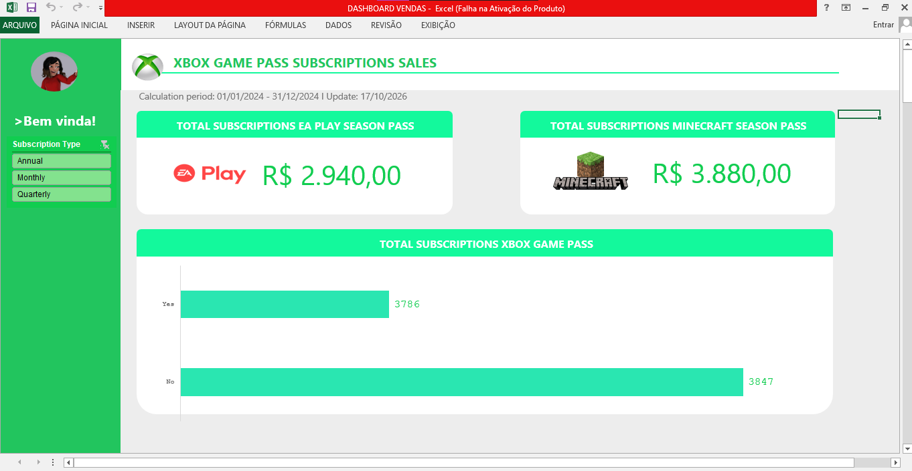

# 🎮 Dashboard de Vendas do Xbox Game Pass com Excel

Projeto desenvolvido no desafio **"Criando um Dashboard de Vendas do Xbox com Excel"** da [DIO](https://www.dio.me/).

O objetivo foi transformar uma base bruta de assinaturas do **Xbox Game Pass** em um dashboard visual e interativo, que responde perguntas de negócio e apoia a tomada de decisões baseada em dados.

## 🖼️ Prévia

## 📁 Arquivos do repositório

| Arquivo | Descrição |
|---|---|
| `DASHBOARD_VENDAS.xlsx` | Pasta de trabalho completa: base de dados, cálculos e dashboard |
| `dashboard.png` | Captura de tela do dashboard |

## 🗂️ Estrutura da planilha

| Aba | Conteúdo |
|---|---|
| **Assets** | Paleta de cores (verdes do Xbox), logos e ícones usados no dashboard |
| **Bases** | Base de dados formatada como tabela, com 295 assinaturas |
| **Cálculos** | Tabelas dinâmicas que respondem às perguntas de negócio |
| **Dashboard** | Painel final com Big Numbers, gráfico e segmentação de dados |

## 📊 Sobre os dados

A base contém **295 assinaturas** do Xbox Game Pass iniciadas entre **01/01/2024 e 31/12/2024**, com as colunas:

`Subscriber ID` · `Name` · `Plan` (Core, Standard, Ultimate) · `Start Date` · `Auto Renewal` · `Subscription Price` · `Subscription Type` (Monthly, Quarterly, Annual) · `EA Play Season Pass` · `EA Play Season Pass Price` · `Minecraft Season Pass` · `Minecraft Season Pass Price` · `Coupon Value` · `Total Value`

## ❓ Perguntas de negócio

1. **Qual o faturamento total de vendas das assinaturas?** (todas as assinaturas agregadas, com filtro por tipo)
2. **Qual o faturamento separado por assinaturas com e sem renovação automática?**
3. **Qual o total de vendas do EA Play Season Pass?**
4. **Qual o total de vendas do Minecraft Season Pass?**

## 🛠️ O que foi feito

- Organização do projeto seguindo o **Método ABCDE**
- Estruturação da base em formato de **tabela** (Data View)
- **Três tabelas dinâmicas** na aba Cálculos para responder às perguntas de negócio
- **Gráfico dinâmico** de barras com o faturamento total e por renovação automática (Yes/No)
- **Segmentação de dados** por *Subscription Type*, conectada às três tabelas dinâmicas, que filtra o painel inteiro
- **Big Numbers** do EA Play Season Pass e do Minecraft Season Pass, ligados às tabelas dinâmicas com `INFODADOSTABELADINÂMICA` (`GETPIVOTDATA`)
- **Info Context** com o período de cálculo (01/01/2024 a 31/12/2024) e a data de atualização
- **Estilização** com a identidade visual do Xbox: paleta de verdes, logos, ícones, menu lateral e mensagem de boas-vindas

## 📈 Principais resultados

**Faturamento por tipo de assinatura**

| Tipo de assinatura | Faturamento total | Com renovação automática | Sem renovação automática |
|---|---:|---:|---:|
| Monthly | R$ 3.571 | R$ 747 | R$ 2.824 |
| Quarterly | R$ 2.308 | R$ 1.502 | R$ 806 |
| Annual | R$ 1.754 | R$ 1.537 | R$ 217 |
| **Total** | **R$ 7.633** | **R$ 3.786** | **R$ 3.847** |

**Season Passes**

| Tipo de assinatura | EA Play Season Pass | Minecraft Season Pass |
|---|---:|---:|
| Monthly | R$ 1.350 | R$ 1.800 |
| Quarterly | R$ 990 | R$ 1.140 |
| Annual | R$ 600 | R$ 940 |
| **Total** | **R$ 2.940** | **R$ 3.880** |

**Insights:**
- Os planos **mensais** geram o maior faturamento, mas a maior parte dele vem de assinaturas **sem renovação automática**, o que indica risco de cancelamento.
- Nos planos **trimestrais e anuais**, a renovação automática concentra a maior parte da receita, o que deixa o faturamento mais previsível.
- O **Minecraft Season Pass** fatura mais que o EA Play e é vendido nos planos **Standard e Ultimate**. O **EA Play** é vendido apenas no **Ultimate**.

## ▶️ Como reproduzir

1. Baixe o arquivo `DASHBOARD_VENDAS.xlsx` deste repositório (botão **Download raw file**).
2. Abra no **Microsoft Excel 2016 ou superior**. A segmentação de dados não funciona no Google Sheets nem no LibreOffice.
3. Na aba **Dashboard**, use a segmentação **Subscription Type** para alternar entre Monthly, Quarterly e Annual.
4. Para usar novos dados, adicione as linhas na tabela da aba **Bases** e clique em **Dados → Atualizar Tudo**.

## 👩‍💻 Autora

**Melissa Yakushijin**: [GitHub](https://github.com/melissayakushijin-oss)
